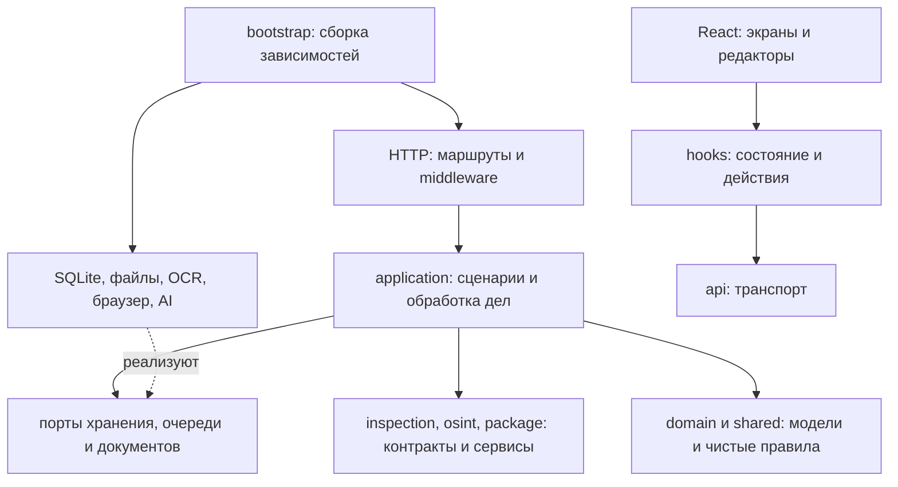

# Архитектура Aigak

Aigak — модульное приложение на TypeScript. HTTP, прикладные сценарии, алгоритмы анализа и внешние адаптеры разделены. Обязательные правила SOLID и проверки для следующих изменений закреплены в [AGENTS.md](../AGENTS.md).

## Направление зависимостей



`server/index.ts` только запускает приложение. `bootstrap/start-server.ts` открывает хранилище, собирает зависимости и подключает Vite или статическую сборку. `http/create-app.ts` создаёт Express-приложение без прослушивания порта и фоновых заданий: тест может передать свои реализации портов.

## Карта каталогов

| Каталог                          | Ответственность                                                                    |
| -------------------------------- | ---------------------------------------------------------------------------------- |
| `server/bootstrap`               | Создание конкретных зависимостей, конвейера обработки и набора извлекателей        |
| `server/http`                    | HTTP-маршруты, multipart, заголовки, локальная защита и отображение ошибок         |
| `server/application/intake`      | Приём материалов, демонстрационный пример, добавление материалов, повторный анализ |
| `server/application/review`      | Отдельные команды проверки находок, ответов, связей и правовых оснований           |
| `server/application/processing`  | Жизненный цикл обработки и заменяемые этапы                                        |
| `server/application/ports`       | Контракты хранения, журналирования, очереди, шаблонов и документов                 |
| `server/domain`, `shared`        | Чистые проверки, общие типы, расчёт готовности и представления результатов         |
| `server/storage`                 | Адаптеры SQLite и неизменяемых файлов                                              |
| `server/collection`              | Получение страниц, извлечение текста, OCR и реализации `FileExtractor`             |
| `server/inspection`              | Реестр проверок, стратегии уровней, фасад исполнения и валидация цитат             |
| `server/ai`                      | Маршрутизация моделей, схемы ответов, протокольные адаптеры                        |
| `server/ai/prompts`              | Общие инструкции и отдельный промпт каждой AI-задачи                               |
| `server/osint`                   | Сборщики DNS/RDAP/TLS, официальные источники и исследование связей                 |
| `server/package`                 | Сборка пакета, чистое оформление, отдельные адаптеры DOCX/PDF/ZIP                  |
| `server/templates`               | Валидация DOCX, встроенный шаблон и поля                                           |
| `src/app`                        | Сборка приложения, экраны приёма/дела, панель навигации и координация действий     |
| `src/features`                   | Компоненты находок, досье, связей и цикла проверки                                 |
| `src/hooks`                      | Состояние формы, язык, фокус панели, асинхронные действия и изменения дела         |
| `src/api`, `src/i18n`, `src/lib` | Клиент HTTP, словари сообщений и чистое форматирование                             |

Старые файлы `workflow.ts`, `collector.ts`, `checks.ts`, `adapters.ts` и некоторые другие пути оставлены как совместимые точки импорта. Новые классы импортируются из собственных файлов. Файл `export.ts` только переэкспортирует сборку документов из bootstrap. Обёртка `extractFile` оставлена для прежних импортов; внутренние сборщики URL и контактных страниц получают один готовый `EvidenceExtractor`, созданный в bootstrap.

## Хранение и шаблоны

`bootstrap/create-local-storage.ts` — единственная точка сборки локального хранилища. Возвращает `{ store, templates, close }`; владелец вызывает `close()` после остановки потребителей. При ошибке инициализации соединение закрывается.

- `application/storage/Store` — фасад портов дел, оригиналов и журнала; не знает SQLite или каталогов.
- `SqliteCaseRepository` читает и сохраняет JSON дел. `domain/hydrate-case` поддерживает старые записи без `analysisLevel`.
- `FileBlobStorage` реализует `BlobStorage`: запись без перезаписи существующего объекта, исходные права файлов и каталогов.
- `EvidenceService` создаёт метаданные оригинала и записывает событие только после сохранения байтов. `AuditLog` строит цепочку хешей; `CaseIntegrityVerifier` проверяет оригиналы, ревизии и журнал.
- `application/templates/Templates` координирует каталог через `TemplateRepository`, `BlobStorage`, `TemplateValidator` и `BuiltinTemplate`. `SqliteTemplateRepository` хранит записи; `DocxTemplateValidator` проверяет DOCX и поля. Реализации заменяются в фабрике.

Схема таблиц, расположение файлов, порядок полей при хешировании и коды ошибок сохранены. SQLite и файловая система по-прежнему не составляют общую транзакцию: этот этап не добавляет атомарность между ними.

Внутренние сигнатуры изменились: вместо `new Store(directory)` используется `createLocalStorage(directory)`, вместо `new Templates(store)` — каталог из фабрики. `createProcessing(store, directory, ai?)` принимает настройки OCR отдельно от хранилища. `exportCase(store, templates, record, includePdf?, service?)` получает каталог явно. HTTP API остался прежним.

## SOLID на практике

- **Single Responsibility.** `Queue` планирует задания; `CaseProcessingService` управляет их жизненным циклом; отдельные этапы отвечают за сбор, паспорт ресурса, обогащение Pro и анализ. HTTP не содержит правил изменения дела. `App` собирает экраны; сетевые действия и состояние вынесены в hooks и контроллер.
- **Open/Closed.** `FileExtractionService` выбирает реализацию через `supports`, проверки регистрируются в `CheckRegistry`, планы создаются `StrategyFactory`. Форматы документов и AI-протоколы подключаются через интерфейсы. Новая реализация требует регистрации, а не изменения общего диспетчера.
- **Liskov Substitution.** Подмена этапа, процессора, извлекателя или рендерера сохраняет соответствующий контракт. Тесты проверяют порядок, жизненный цикл, сохранение материалов при ошибках и работу API с подставными документами. Ошибка источника не превращается в успешный результат без ограничений.
- **Interface Segregation.** Хранение дел, работа с оригиналами и журнал разделены на `CaseRepository`, `EvidenceStorage` и `AuditWriter`. Потребители используют необходимые методы через отдельные порты или `Pick`. `JobQueue` раскрывает только добавление и длину ожидания.
- **Dependency Inversion.** Прикладной слой получает порты и функции через конструкторы/аргументы. Он не импортирует Express, SQLite, браузер или файловое хранилище. `InspectionFacade` зависит от `CheckResolver`, `StrategyResolver` и `AiAnalyzer`, а `GatewayAnalyzer` — от `ModelGateway`.

Один класс находится в одном файле с тем же именем. Функции сценариев и чистые преобразования остаются функциями: наследование и абстрактные базовые классы не нужны, когда достаточно интерфейса.

## Обработка дела

1. Команда приёма проверяет данные, сохраняет оригиналы и ставит дело в очередь.
2. `Queue` последовательно вызывает переданный `CaseProcessor`.
3. `CollectionStage` получает URL и извлекает текст. `FileExtractionService` использует `TextExtractor`, `PdfExtractor` или `ImageExtractor`; OCR передаётся через `OcrEngine`.
4. `ResourceProfileStage` собирает паспорт ресурса и контактные страницы.
5. `ProEnrichmentStage` добавляет официальные источники и исследование связей для Pro.
6. `InspectionStage` вызывает фасад, сохраняет результаты и вопросы инспектору.
7. Процессор завершает дело статусом `review`. При сбое сохраняет доступные материалы, ограничение и событие `processing.failed`.

Незавершённые дела после перезапуска помечаются прерванными. Очередь пока локальная, последовательная и не является распределённой системой заданий.

## Контракты и инварианты

- Basic не вызывает AI. Advanced выполняет контекст, механику и проверку. Pro добавляет связи, правовые гипотезы и итоговую проверку.
- Цитата должна совпадать с точным диапазоном сохранённого текста. Выводы разных этапов не считаются независимыми доказательствами.
- Лимиты времени, попыток и отмена не зависят от протокола AI-провайдера. Инструкции отделены от недоверенных материалов.
- Ручные правки снимают подтверждение. Повторный анализ сохраняет предыдущую версию. Новые материалы требуют повторной проверки.
- Пакет получает снимок данных; его сборка не запускает сбор источников или AI. Ошибка PDF оставляет DOCX/HTML и предупреждение. Нарушение целостности останавливает сборку.
- API сохраняет локальную проверку Host/Origin, клиентский заголовок, ограничения multipart и sandbox/CSP предпросмотра.
- Формат SQLite, оригиналов и аудитного журнала сохранён; миграция существующих дел не требуется.

## Добавление реализации

**Новый формат входного файла:** реализовать `FileExtractor` в собственном файле, зарегистрировать в `bootstrap/create-extraction.ts`, проверить результат, ошибку и связь производного материала с оригиналом.

**Новая проверка:** реализовать `InspectionCheck`, зарегистрировать конструктор в `inspection/index.ts`, включить ID в нужную стратегию и пересмотреть бюджет. Проверить цитаты, отсутствие данных и сбой провайдера.

**Новый AI-протокол:** реализовать `ModelAdapter`, зарегистрировать его в фабрике анализатора и добавить контрактные тесты. Промпты хранятся отдельно в `ai/prompts`; при изменении текста обновляется версия.

**Другой способ хранения:** реализовать порты и передать их прикладным сценариям. Полный перенос SQLite-шаблонов и файловых OCR-моделей также требует соответствующих инфраструктурных адаптеров в bootstrap.

**Другой формат пакета:** реализовать нужный интерфейс из `package/contracts.ts`, передать его сервису через фабрику. Новый внешний сервис не требует изменения правил анализа.

## Проверка изменений

```bash
npm run format
npm run check
```

`check` включает Prettier, ESLint, проверку архитектуры, тесты, TypeScript и production-сборку. Архитектурная проверка запрещает несколько классов в файле, неверные имена файлов классов, циклические зависимости времени исполнения и нарушения границ слоёв. ESLint проверяет также правила React hooks и запрещает явный `any`.

Механические проверки не доказывают SOLID автоматически. При ревью дополнительно проверяются причины изменения модуля, размер контракта и возможность заменить зависимость без изменения вызывающего кода.

Детали анализа: [AI Gateway](AI_GATEWAY.md), [OSINT и Pro](PRO_OSINT.md). Продуктовые ограничения и качество экспертных выводов остаются такими же, как до рефакторинга.

## Проверка интерфейса

`npm run test:ui` собирает клиент и запускает `scripts/smoke-ui.mjs` на временном `DATA_DIR`. Нужен установленный Chrome; канал браузера можно задать через `SMOKE_BROWSER`, порт — через `SMOKE_PORT` (по умолчанию 4329). Сценарий проверяет демонстрацию, решение по находке, пакет, содержимое предпросмотра, RU/KK, историю и Escape, добавление материалов и мобильный viewport. Внешние запросы браузера блокируются; демонстрация не вызывает AI. После проверки процесс и временные данные удаляются.
