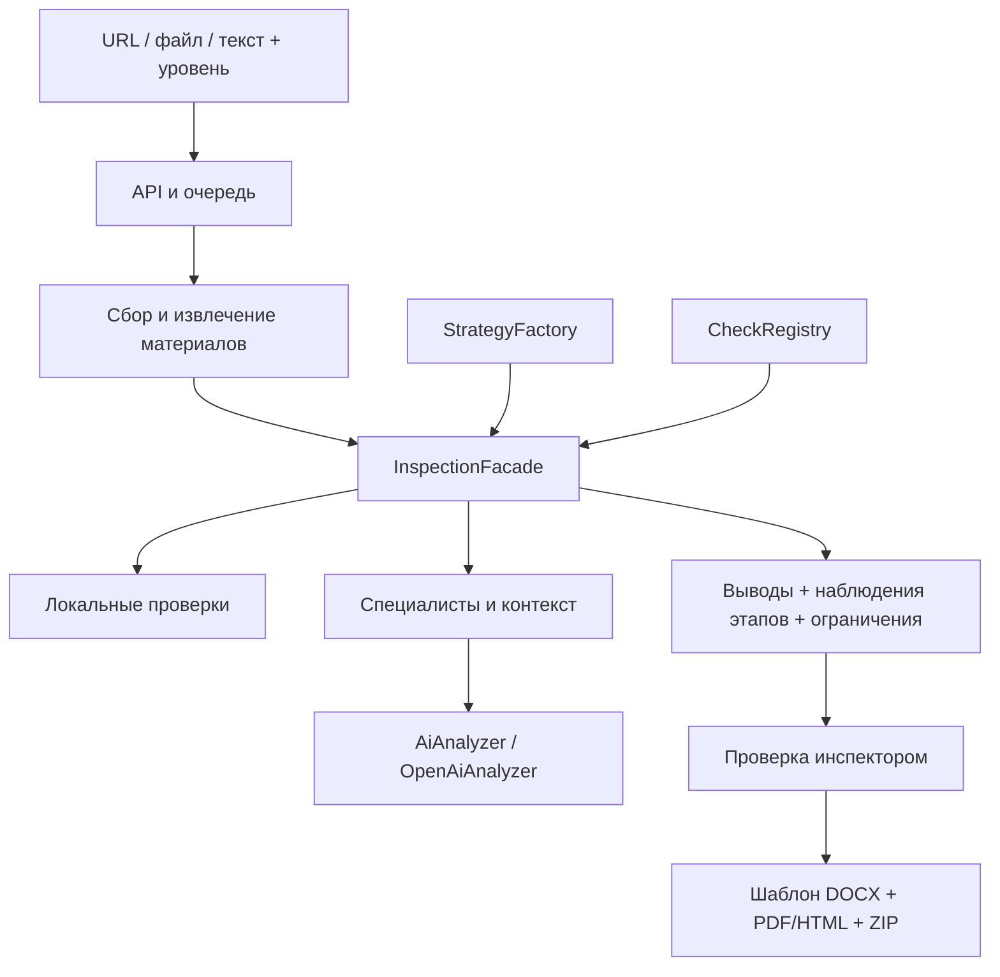
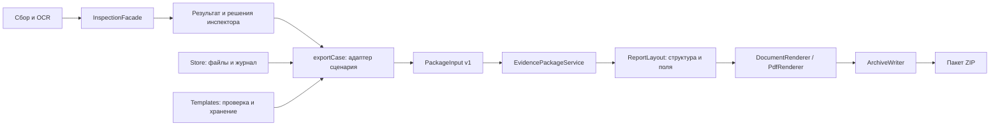

# Расширяемый анализ aigak

## Поток

## Паттерны и ответственность

| Паттерн | Модуль | Зачем |
|---|---|---|
| Strategy | server/inspection/strategies.ts | Порядок проверок, лимит запросов и времени для каждого уровня |
| Factory | StrategyFactory | Создание стратегии по выбранному уровню |
| Registry + Factory | CheckRegistry | Регистрация конструкторов проверок; отдельный экземпляр на дело |
| Facade | InspectionFacade | Единый вход, выполнение, проверка цитат, обработка ошибок и журнал |
| Adapter | AiAnalyzer / OpenAiAnalyzer | Замена поставщика ИИ без изменений очереди и интерфейса |
| Dependency Injection | createInspectionFacade, Queue | Сборка зависимостей и тестирование без сети |

Composition root — server/inspection/index.ts. Конкретные проверки известны ему,
а очередь зависит только от фасада. Не нужен отдельный микросервис для каждого специалиста.

## Режимы

- Basic: rules → integrity. Ноль запросов к модели, без процента.
- Advanced: rules → context → integrity. До одного запроса.
- Pro: rules → mechanics → promotion → payments → context → connections → legal → integrity.
  До четырёх запросов, общий срок 180 секунд.

Узкие проверки анализируют один сохранённый набор материалов. Контекстная проверка получает
их кандидатов и исходные свидетельства, ищет альтернативные объяснения и формирует итоговый
набор признаков. Предыдущие наблюдения остаются в inspection.stages[].observations.
Итог не является голосованием или средним арифметическим вероятностей агентов.
Все выбранные цитаты проверяются по точному диапазону исходного текста.

Connections и Legal пока возвращают skipped. Они не делают внешних запросов и не выдают
правовую квалификацию. Pro на этом этапе всегда partial. Любой пропуск/сбой убирает
итоговый процент. Остальные результаты доступны инспектору и для экспорта проекта.

## Добавить проверку

1. Реализовать InspectionCheck из contracts.ts: id, version, RU/KK name, requiresAi, execute.
2. Зарегистрировать конструктор в createInspectionFacade:
   `registry.register('new-check', () => new NewCheck())`.
3. Добавить id в checks нужной стратегии, пересмотреть maxAiCalls и timeoutMs.
4. Проверить на тестовых материалах: цитаты, ложные срабатывания, отсутствие данных, ошибка провайдера.

Метод execute получает копии материалов и предыдущих находок, ссылки и AbortSignal.
Для модели использовать context.analyze(focus): фасад учитывает бюджет. Внешние запросы
будущих адаптеров должны уважать AbortSignal, ограничения SSRF и сохранять полученные
источники как новые материалы с происхождением. Сейчас эти возможности не реализованы.
Таймаут фасада прекращает ожидание даже адаптера, игнорирующего отмену;
физическое прекращение его внешней работы зависит от соблюдения AbortSignal.

CheckResult возвращает completed/skipped, summary и findings. requiresAi=false не даёт
обойти бюджет через context.analyze. replaceFindings предназначен для итогового контекста.
Новый источник нельзя цитировать, пока он не включён в сохранённые evidence.

## Следующая итерация

1. Размеченный корпус RU/KK: реклама, новости, критика, легальные предложения,
   неоднозначные скриншоты. Измерять precision/recall и стоимость/время по режимам.
2. Юридический адаптер: официальные источники РК, редакция и дата нормы,
   применимость, точная цитата, ссылка и обязательное подтверждение специалистом.
3. Детектив: ограниченный поиск публичных источников, проверка связи,
   сохранение страниц, граф с основаниями и альтернативными объяснениями.
4. Уточнения по конкретным спорным находкам и повторный анализ с версионированием.
5. Калибровка оценки на независимой выборке; сравнить пользу специалистов с Advanced.

Большое число агентов само по себе не доказывает точность. Пока это расширяемый MVP,
а не валидированная экспертная или юридическая система.

## Границы модулей после итерации 3

- **server/rules/** — детерминированный анализ. Каталог отделён от алгоритма сопоставления.
  Правило добавляется в terms/combinations/contexts, затем проверяется на RU/KK примерах.
- **server/inspection/** — выполнение стратегий и специалистов. Не импортирует генераторы документов.
- **server/templates.ts** — проверка и хранение пользовательских шаблонов. Не форматирует результаты.
- **server/export.ts** — адаптер приложения: проверяет хранилище, пишет событие запроса,
  преобразует CaseRecord в PackageDocument, читает файлы и вызывает сервис.
- **server/package/contracts.ts** — контракт передачи данных и интерфейсы зависимостей.
- **server/package/service.ts** — независимый сервис сборки: снимок входа, проверка файлов
  и ссылок находок, порядок подтверждённых/ожидающих/отклонённых наблюдений, форматы, манифест.
  Не зависит от HTTP, Store, коллектора, правил или ИИ.
- **server/package/html.ts / fields.ts** — стандартная логика оформления одного снимка
  в HTML и поля DOCX. Оба представления получают одинаковые данные.
- **server/package/adapters.ts** — реализации DOCX, Playwright PDF, JSZip и стандартного layout.
- **server/package/index.ts** — сборка зависимостей по умолчанию.

Сервис вызывается как `service.build({ document, evidenceFiles, templates, layoutId, includePdf })`
и возвращает `{ bytes, warnings, files }`. Данные и буферы копируются до первого ожидания:
последующие изменения инспектора не меняют собираемый пакет. Это не криптографическая подпись;
доверие к хранилищу и журналу остаётся ответственностью адаптера приложения.

Для нового оформления реализовать ReportLayout (html и fields), зарегистрировать его
в composition root и передать layoutId. Для нового генератора реализовать соответствующий
интерфейс. Выделять сетевой микросервис сейчас не требуется: будущий транспорт сможет
передавать тот же DTO и файлы, добавив аутентификацию, ограничения размера и очередь.

Сбой PDF сохраняет HTML/DOCX и предупреждение в архиве. Ошибка контрольных сумм,
недостающий файл, неизвестный layout или несвязанная цитата останавливают сборку.
Пакет остаётся проектом независимо от внутреннего подтверждения инспектором.
